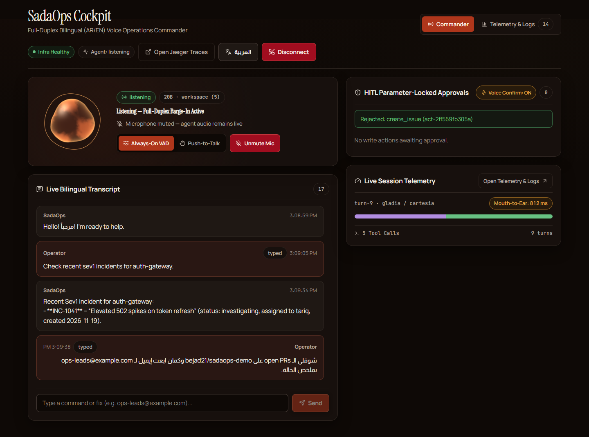
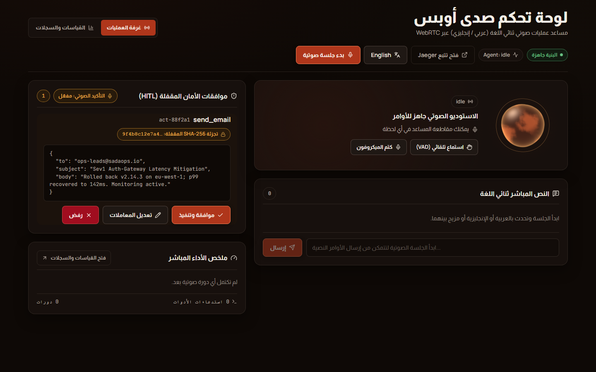
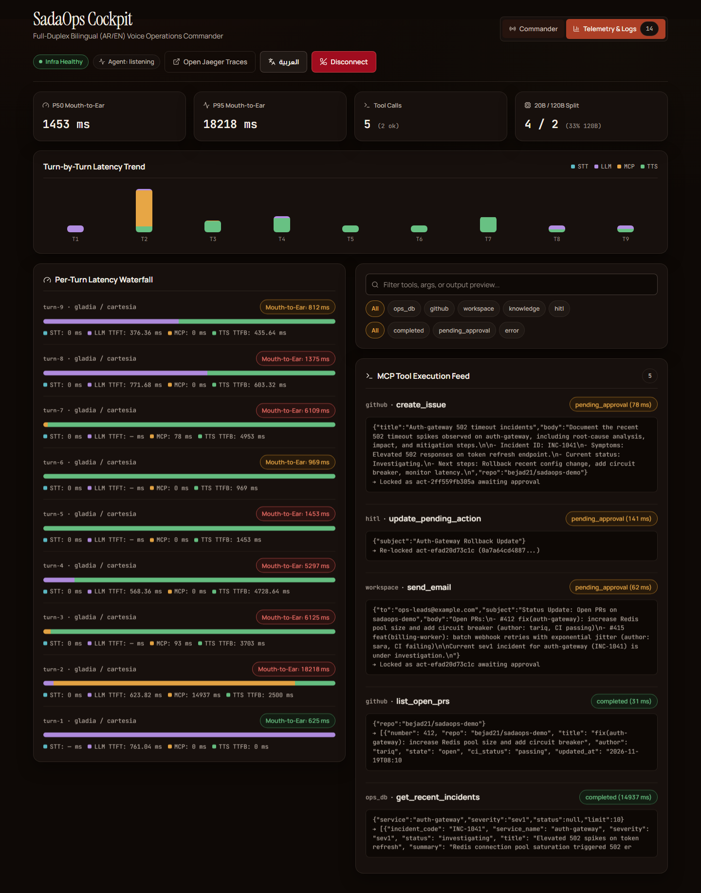
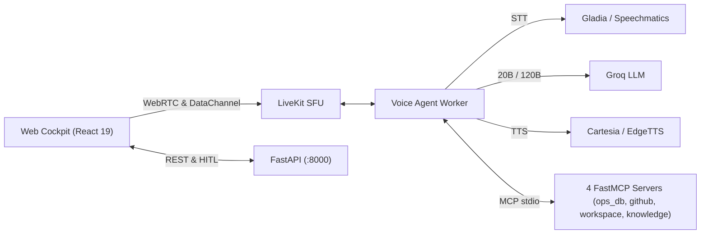

# SadaOps

> Bilingual (Arabic + English) real-time voice and text operations assistant for incidents, GitHub, runbooks, and workspace tools — with built-in safety approvals.

[](https://www.python.org/downloads/)
[](https://react.dev/)
[](https://modelcontextprotocol.io/)

## Table of Contents

- [Features](#features)
- [Screenshots](#screenshots)
- [Prerequisites](#prerequisites)
- [Quick Start](#quick-start)
- [Example Prompts](#example-prompts)
- [Optional Integrations](#optional-integrations)
- [Architecture & Benchmarks](#architecture--benchmarks)
- [Testing](#testing)
- [Documentation](#documentation)

---

## Features

- **Bilingual Voice & Chat:** Speak or type in English, Arabic, or code-switched Arabic/English with live RTL support (`dir="ltr" | "rtl"`).
- **4 Tool Servers (MCP):**
  - **Ops DB:** Query incidents, service metrics, and read-only SQL (`sqlglot` AST firewall).
  - **GitHub:** List repos, open PRs, recent commits, CI failure logs, and create issues.
  - **Workspace:** Check/read/summarize Gmail or Mailpit emails and manage Google Calendar / local events.
  - **Knowledge & Math:** Search bilingual runbooks in Qdrant and run Python calculations in an isolated Docker sandbox.
- **Safe Approvals (HITL):** Write actions (`send_email`, `create_calendar_event`, `update_calendar_event`, `delete_calendar_event`, `create_issue`) require explicit UI or voice confirmation with SHA-256 payload locking.
- **Live Observability:** Built-in Telemetry & Logs view plus OpenTelemetry traces in Jaeger.

---

## Screenshots

### Commander View (English & Code-Switching)


### Arabic RTL Layout & Parameter-Locked HITL Approval


### Telemetry & Logs View (Latency Waterfall & MCP Feed)


---

## Prerequisites

- **Docker Desktop** (running)
- **Python 3.11+**
- **Node.js 20+**
- **API keys** in `.env`:
  - **Required:** `GROQ_API_KEY` + `GLADIA_API_KEY` *(or `SPEECHMATICS_API_KEY`)*
  - **Optional:** `CARTESIA_API_KEY` (fast voice TTS), `GITHUB_TOKEN` (live GitHub), `GOOGLE_CLIENT_ID` & `GOOGLE_CLIENT_SECRET` (live Gmail/Calendar)

---

## Quick Start

1. **Configure environment**
   ```bash
   cp .env.example .env
   ```
   Open `.env` and add your `GROQ_API_KEY` and `GLADIA_API_KEY` (or `SPEECHMATICS_API_KEY`).

2. **Start local infrastructure (LiveKit, Postgres, Qdrant, Jaeger, Mailpit)**
   ```bash
   docker build -t sadaops-python-sandbox:latest infra/sandbox
   docker compose -f infra/docker-compose.yml up -d --wait
   ```

3. **Install dependencies & download local voice models**
   ```bash
   python -m venv .venv
   # Windows:
   .venv\Scripts\pip install -r requirements.txt
   .venv\Scripts\python -m livekit.agents download-files
   # macOS / Linux:
   # .venv/bin/pip install -r requirements.txt && .venv/bin/python -m livekit.agents download-files

   cd web && npm ci && cd ..
   ```

4. **Run SadaOps (3 terminals)**
   ```bash
   # Terminal 1: API control plane
   uvicorn api.app:app --reload --port 8000

   # Terminal 2: Voice & MCP agent worker
   python -m agent.main dev

   # Terminal 3: Web Cockpit UI
   cd web && npm run dev
   ```

Open the Cockpit at **http://localhost:5173** *(API health: `http://localhost:8000/health` | Jaeger: `http://localhost:16686` | Mailpit: `http://localhost:8025`)*.

---

## Example Prompts

- *"What are the latest sev1 incidents and which service has the highest error rate?"*
- *"How many repos do I have on GitHub, and did any CI runs fail recently?"*
- *"How many unread emails do I have, and who are my top senders?"*
- *"شوفلي الـ sev1 incidents وابعت إيميل لـ ops-leads@example.com بالملخص"*

---

## Optional Integrations

SadaOps works offline out of the box using local Postgres, Mailpit, and fixture GitHub data. To connect real accounts, see the **[Setup & Integrations Guide](docs/setup.md)**:
- **GitHub (All Repos):** Set `GITHUB_MODE=live`, `GITHUB_TOKEN`, and `GITHUB_ALLOWED_REPOS=*` in `.env`.
- **Google Workspace (Gmail & Calendar):** Add `GOOGLE_CLIENT_ID` and `GOOGLE_CLIENT_SECRET`, then click **Connect Google** in the Cockpit.

---

## Architecture & Benchmarks



| Benchmark | Result | Details |
|---|---|---|
| **Bilingual Ops Suite (60 scenarios)** | **96.7% (`58/60`)** | Gladia + Scoped `20B`/`120B` Supervisor |
| **VoiceAgentBench (150 items)** | **68.0%** (`100%` safety refusal) | Multi-step spoken tool calling |
| **Code-Switching ASR (300 clips)** | **0.478 WER** (`2.03s` p50) | Speechmatics `ar_en` vs `0.791` Whisper |
| **TTS First-Byte Latency** | **250.8 ms** mean TTFB | Cartesia Sonic-3 vs `4134 ms` EdgeTTS |

---

## Testing

```bash
ruff check .
pytest -v
cd web && npm test -- --run && npx tsc --noEmit
```

---

## Documentation

- [Setup & Optional Integrations](docs/setup.md)
- [System Architecture](docs/architecture.md)
- [Security & Threat Model](docs/security.md) (and [`SECURITY.md`](SECURITY.md))
- [Operations & Troubleshooting](docs/operations.md)
- [Evaluation Methodology](docs/evaluation.md)
- [Contributing Guide](CONTRIBUTING.md)
