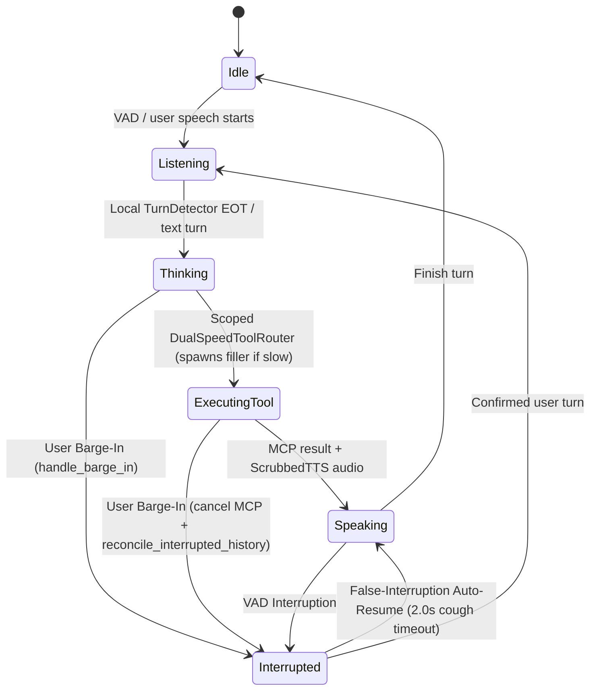

# System Architecture (`docs/architecture.md`)

## Component Overview

SadaOps separates real-time media transport, safety enforcement, tool execution, and operator UI into independent boundaries:

1. **Web Cockpit (`web/`)**: React 19 UI using LiveKit WebRTC client (`livekit-client`), per-tab unique room session isolation, live English/Arabic RTL layout switch (`dir="ltr" | "rtl"`), **in-app `Commander` | `Telemetry & Logs` workspace switcher** (preserving active WebRTC audio across views), a dual-channel Fresnel 3D WebGL **Acoustic Stage** bound to Web Audio `AnalyserNode`, **Always-On VAD / Mic Mute / Push-to-Talk (`Space` & pointer hold)** controls, real-time voice + typed chat transcript stream (`sadaops.send_text` RPC + `lk.chat` TextStream fallback with `"typed"` badge), live model/domain route pill (`20B` vs `120B Supervisor`), inline HITL Parameter Editor + **Voice Confirmation / UI-Only Lock toggle** (`sadaops.set_voice_hitl` RPC), and a dedicated **Telemetry & Logs** view (P50/P95 Mouth-to-Ear KPIs, `20B`/`120B` routing split, turn trend chart, waterfall history, and searchable/filterable MCP execution logs).
2. **Control Plane (`api/app.py`)**: FastAPI service exposing `/health`, `/api/token` (LiveKit room JWT minting), and HITL endpoints (`/api/hitl/pending`, `/api/hitl/propose`, `/api/hitl/update`, `/api/hitl/approve`, `/api/hitl/reject`) backed by PostgreSQL + LiveKit DataChannel room broadcasts.
3. **Voice Agent Worker (`agent/main.py`)**:
   - **STT (`agent/pipeline/stt_adapter.py`)**: Primary Gladia `solaria-1` (`languages=["ar", "en"]`, `code_switching=True`, `SADAOPS_ADDITIONAL_VOCAB` + shared `GLADIA_CUSTOM_SPELLING`) or Speechmatics (`language="multi"` live with `vad=None`), wrapped in LiveKit `stt.FallbackAdapter` with Groq `whisper-large-v3-turbo`.
   - **Scoped Orchestrator & LLM Router (`agent/pipeline/orchestrator.py`, `agent/pipeline/llm_router.py`)**: Routes simple single-domain turns to `openai/gpt-oss-20b` with narrow domain tools (+ `escalate_to_supervisor`), and escalates cross-domain/multi-step turns to `openai/gpt-oss-120b` (`SupervisorWorkflowTask(AgentTask[str])`), combining consecutive unanswered user fragments across STT splits, capping `max_completion_tokens=600` on live `groq.LLM` candidates, and failing over across dual Groq keys.
   - **TTS (`agent/pipeline/tts_adapter.py`)**: `ScrubbedTTS` incremental streaming wrapper forwarding `metrics_collected` / `error` events ahead of `Cartesia` (`sonic-3` multilingual `Raed` voice) or free `EdgeTTS` (`pick_bilingual_voice`).
   - **Turn Handling & Cough-Safe Resume (`agent/main.py`, `agent/pipeline/turn_manager.py`)**: LiveKit `TurnHandlingOptions` with local ONNX `inference.TurnDetector(version="v1-mini")`, dynamic endpointing (`min_delay=1.0`, `max_delay=3.5`), VAD interruption (`false_interruption_timeout=2.0`, `resume_false_interruption=True`), serialized `TurnManager` (including `resume_after_false_interruption()`), active-job `_worker_load` reporting on `AgentServer`, prewarmed imports, and `@session.on("close")` room cleanup.
   - **Voice HITL Decisions & Revisions (`agent/main.py`, `agent/safety/hitl_gate.py`)**: Pre-existing session pending actions seed `_pending_action_ids` on connect; when pending actions exist, `update_pending_action` is dynamically exposed so operators can revise parameters by voice (`validate_write_policy` + SHA-256 re-lock + cross-turn `proposed_in_turn` reset). Revision utterances (`"No, change..."` / `"عدّل..."`) bypass rejection matching, while short voice confirmations/rejections short-circuit parallel LLM replies via `StopResponse` (toggleable to UI-only via `sadaops.set_voice_hitl`).
4. **Decoupled Tool Plane (`mcp_servers/`)**: Four standalone **MCP (`MCPServer`)** stdio servers managed in per-server `asyncio.Task` lifecycles with least-privilege env allowlists (`build_mcp_server_env`), official `mcp.types.ToolAnnotations` (`readOnlyHint`, `destructiveHint`, `idempotentHint`, `openWorldHint`, inspectable via `MCPServerPool.list_tool_annotations()`), connected repo resolution (`resolve_connected_repo()`), PostgreSQL schema metadata, shutdown callbacks (`ctx.add_shutdown_callback`), and `DualSpeedToolRouter` emitting bilingual spoken fillers (`add_to_chat_ctx=False`, default `0.35s` delay on slow tools).
5. **Observability (`agent/pipeline/telemetry.py`)**: Exports turn-level OTLP HTTP spans (`sadaops-agent`) to Jaeger (`:4318` -> UI `:16686`) tracking STT, LLM TTFT, MCP execution, and TTS TTFB stages.

## Turn & Barge-In State Machine

## Four FastMCP Domains

| Server | Tools Exposed | Backing Infrastructure |
|---|---|---|
| `mcp_servers/ops_db_mcp` | `get_recent_incidents`, `get_service_metrics`, `run_readonly_sql` | PostgreSQL `ops_readonly` role + `sqlglot` AST firewall |
| `mcp_servers/github_mcp` | `list_repos`, `list_open_prs`, `list_commits`, `get_ci_logs`, `get_issue_details`, `create_issue` | `FixtureGitHubAdapter` or `LiveGitHubAdapter` (`GITHUB_MODE=live`, multi-repo `GITHUB_ALLOWED_REPOS=*` + short-name resolution) |
| `mcp_servers/workspace_mcp` | `list_calendar_events`, `find_free_slots`, `create_calendar_event`, `update_calendar_event`, `delete_calendar_event`, `search_inbox`, `analyze_inbox`, `read_email`, `send_email` | Google OAuth2 (Gmail + Calendar) with PostgreSQL `calendar_events` + Mailpit SMTP/API fallback |
| `mcp_servers/knowledge_sandbox_mcp` | `search_runbooks`, `run_python_calc` | Qdrant (`paraphrase-multilingual-MiniLM-L12-v2`) + Docker `--network=none` |
